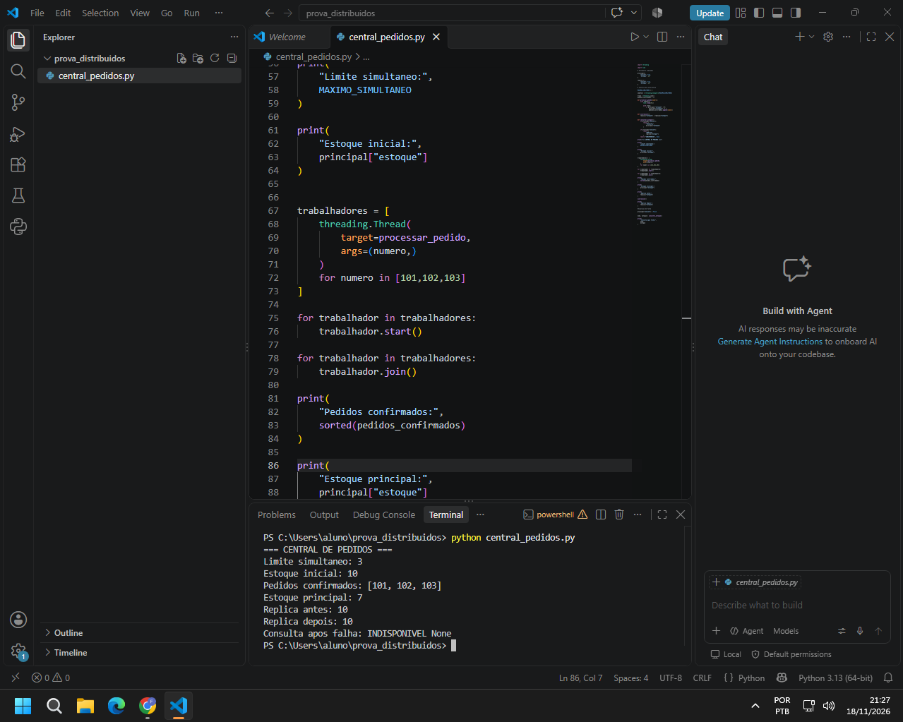
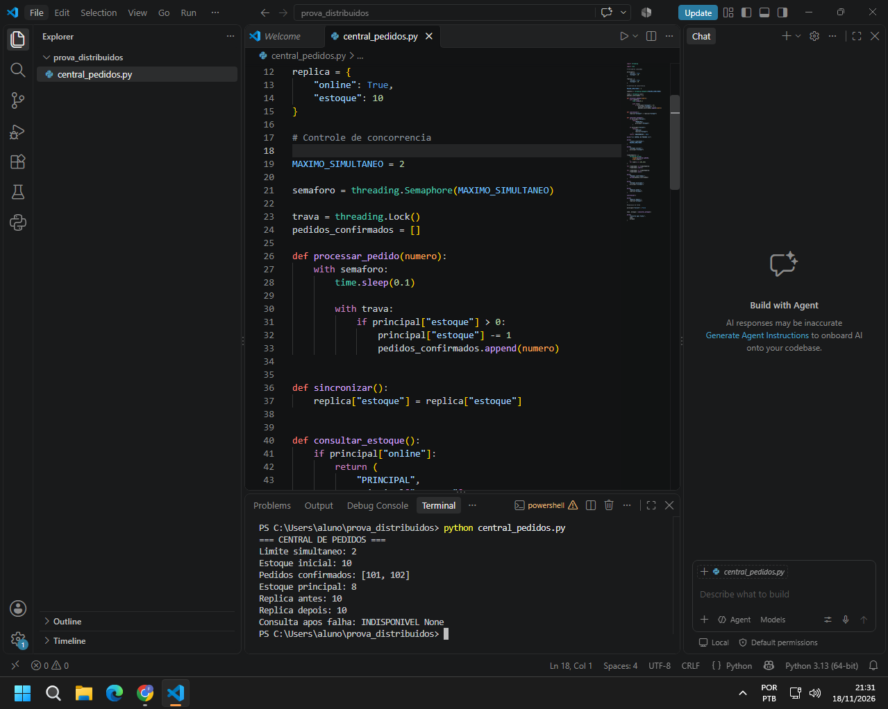
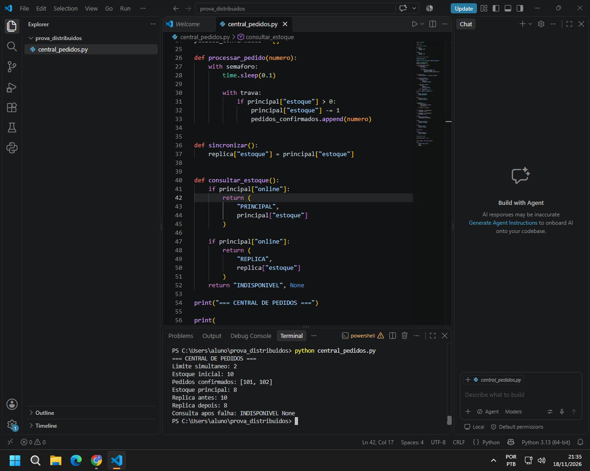
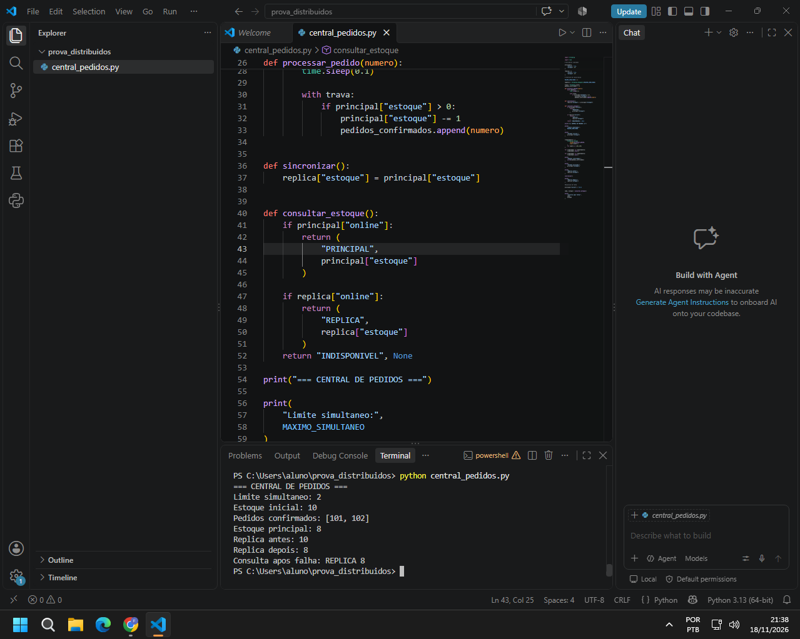
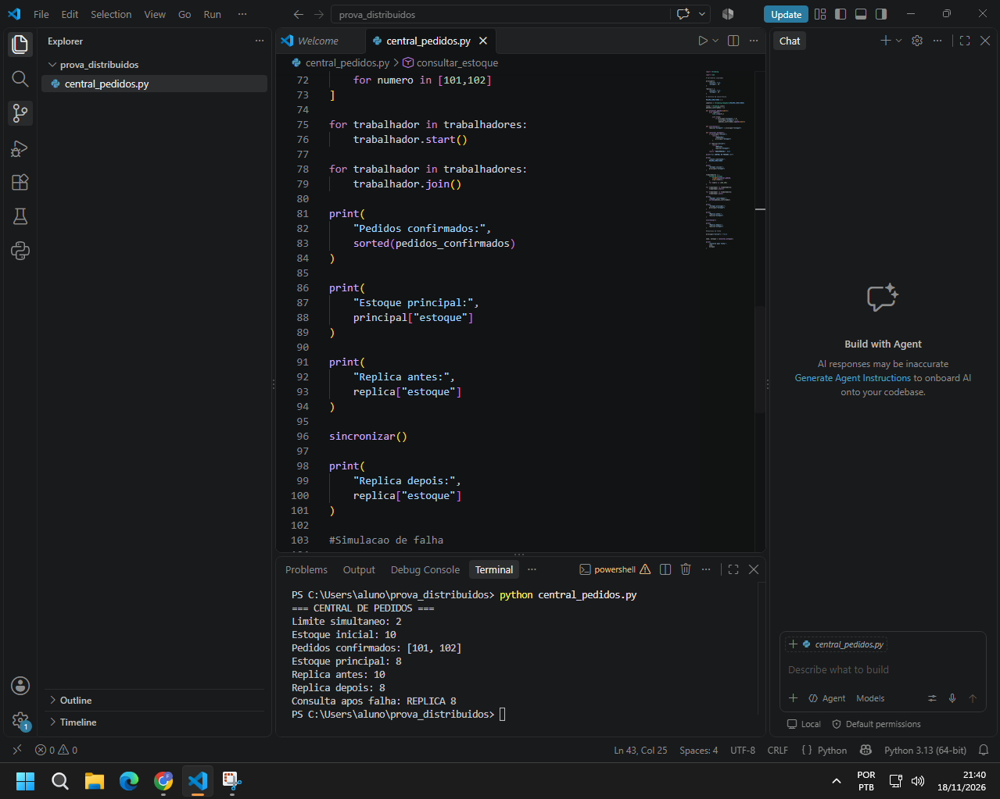

# P2 - Sistemas Distribuídos

**Aluno:** Felipe Antonio Souza Marcello

**Professora:** Simone Tatiane do Canto

## 1. Situação-problema

Descreva brevemente os problemas apresentados na central de Pedidos Distribuída.

Os problemas apresentados foram: números de pedidos simultâneos que no inicio eram 3 com a alteração do codigo foi para 2,
o segundo erro não estava sincronizando o servidor principal e a replica e no terceiro não estava consultando o estoque com o sistema "offline"

## 2 . Primeira execução 

Explique o que foi observado ao executar o programa pela primeira vez.

Foi observado que o limite simultaneo eram 3, estoque inicial 10, pedidos confirmados (101,102,103), o estoque principal diminuiu 3 pedidos e ficou com 7,
replica antes com 10, replica depois 10, consulta apos falha indisponivel.

### Evidência 1 - Primeira execução

### 3 . Problema A - Concorrência

Qual problema foi identificado?

Foi identificado que poderiamos fazer apenas 2 pedidos simultaneos.

Qual alteração foi realizada?

na linha MAXIMO_SIMULTANEO foi trocado de 3 para 2

### Evidência 2 - Concorrência

### 4. Problema B - Replicação e consistência

Qual problema foi identificado?

o estoque do servidor da replica não atualizava igual o do servidor principal

Qual alteração foi realizada?

apos a linha def sincronizador trocamos principal["estoque"] por replica["estoque"]

### Evidência 3 - Sincronização

### 5. Problema C - Tolerância a falhas

Qual problema foi identificado?

o servidor principal estava falhando

Qual alteração foi realizada? 

na linha def consulta_estoque foi alterado principal por replica

### Evidência 4 - Tolerância a falhas

### 6. Validação do programa

Descreva os resultados observados após as três correções

apos as  três correções obtivemos esse resultado

### Evidencia 5 - Execução completa

### 7. Análise tecnica

###Questão 1 
O semáforo limita a quantidade de threads que podem ser executado simultaneamente e evitando sobrecarga

###Questão 2
E necessário caso o servidor principal caia entra a replica para o substituir mesmo estando desatualizada

###Questão 3
Significa que caso tenha falhas o código ira continuar sendo executado, ela foi mostrada nesse codigo a traves da replica mesmo estando errado ele continua sendo executado

###Questão 4
Serve para que somente 1 threads pode ser modificado por vez assim evitando que ocorra erro de estoque

###Questão 5
Depois porque tem que atualizar o valor de estoque, os pedidos são processados no servidor principal, O estoque é alterado conforme os pedidos realizados e Após essa atualização, a sincronização envia o novo valor para a réplica.

### 8. Conclusão

